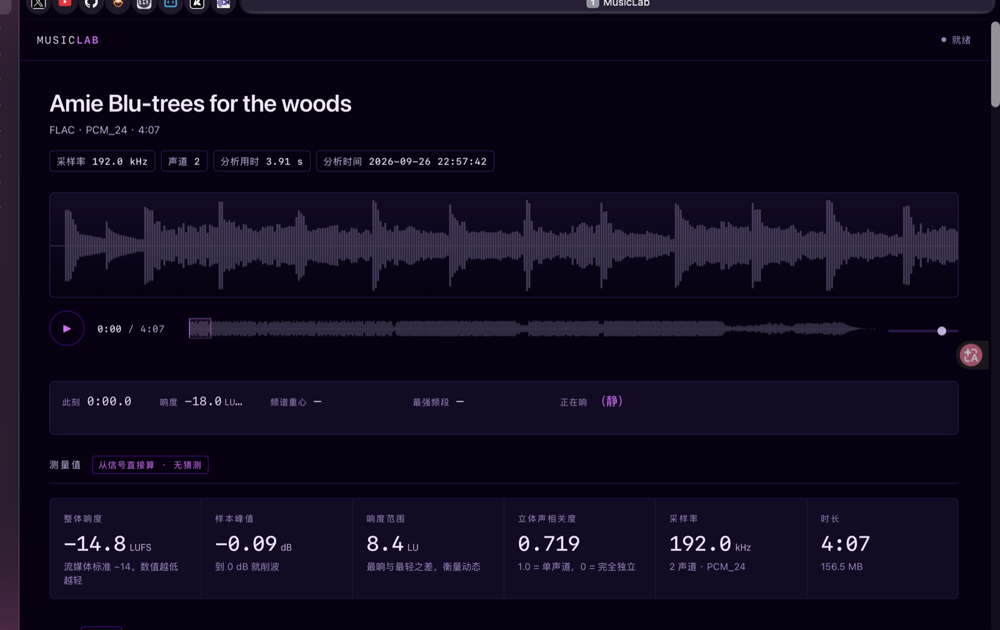
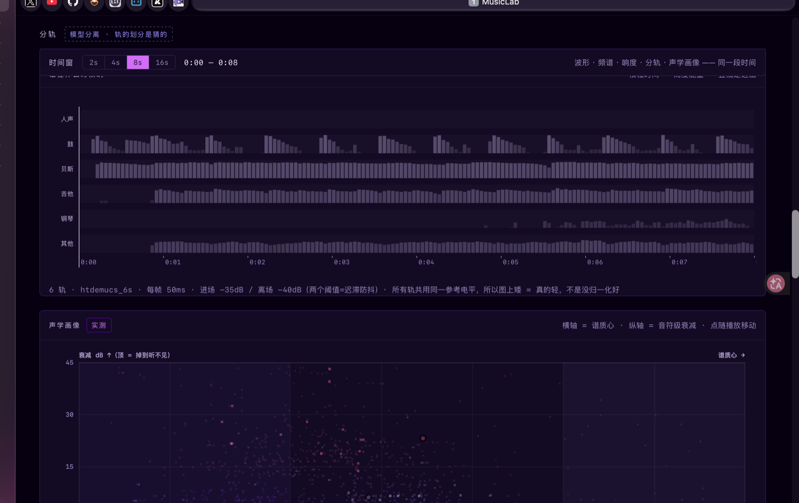

# aesmsic

本地音频信号分析与播放工具。运行在本机，音频不上传，不连接任何外部服务，不发起外部请求。

将任意音频文件读成可测量的数据：波形、频谱、响度（LUFS / 样本峰值 / LRA）、五段频带占比、立体声相关度、BPM 与调性，以及六轨分离后每条轨的逐帧能量与进出事件。所有面板共用同一时间轴 —— 既能查看全曲结构，也能放大到两秒窗口。





---

## 数据模型：measured 与 estimated

每个数据块都带一个 `method` 字段，取值为两个之一：

| 值 | 定义 | 渲染 |
|---|---|---|
| `measured` | 从采样点直接计算 | 实线 |
| `estimated` | 模型推断 | 虚线 |

**实测**：波形、频谱、LUFS、样本峰值、LRA、频段占比、立体声相关度。这些是对信号直接运算的结果，误差来源是算法实现，不是判断。

**估计**：BPM、调性、分轨标签。分别由 beat tracker、Krumhansl-Schmuckler 音阶剖面、Demucs 源分离给出，均存在错误率。

区分二者是接口层的要求，不是免责声明：如果两类数据以相同方式呈现，使用者无法判断哪一格可以据此决策。

分轨面板固定显示以下说明：

> 6 轨 · htdemucs_6s · 每帧 50ms · 进场 −35dB / 离场 −40dB（双阈值迟滞）
> 所有轨共用同一电平标尺，纵轴表示绝对能量，未做归一化

> 数据可以确定「该时刻存在一个声源」，不能确定「该声源是钢琴」。

---

## 安装与运行

### 依赖

```bash
python3 -m venv .venv
source .venv/bin/activate
pip install -r requirements.txt
```

分轨功能额外需要 `demucs` 与 `torch`（约 2 GB，Apple Silicon 使用 MPS 后端）。未安装时其余功能正常，仅缺少分轨与逐帧能量面板。

### 导入音频

将文件放入 `media/`，支持 `.flac` `.wav` `.m4a` `.ogg`。

命名建议 `Artist-Title.ext` —— 索引按第一个 `-` 切分，无法切分时以完整文件名作为标题。

### 启动

```bash
./start.sh          # http://127.0.0.1:8900
./start.sh stop
```

性能参考（M5 / 16 GB，4 分钟曲目）：

| 阶段 | 耗时 |
|---|---|
| 波形 + 频谱 + 响度 | 约 6 秒 |
| 六轨分离 + 逐帧能量 | 约 20 秒 |

分轨结果延迟写入，完成后前端自动加载，无需刷新。

### 桌面外壳（可选，macOS）

```bash
cd app && ./build.sh
```

需要 Xcode Command Line Tools，不需要完整 Xcode，不需要签名证书。

外壳是一个 WKWebView 容器，负责三件事：创建窗口、在服务未运行时启动服务、退出时只终止自己启动的进程。编译时会将仓库路径写入 `Info.plist` 的 `AESMSICLabPath`，因此安装到 `/Applications` 后仍能定位 `server.py`。

---

## 架构

```
media/            音频文件（不纳入版本控制）
  ↓
pipeline.py       常驻进程，每 3 秒扫描 media/，只补缺失项
  ├─ analyze.py            波形 / 频谱 / LUFS / 峰值 / LRA / 频段 / 立体声
  │                        → analysis/<id>.json
  └─ demucs + analyze_stems.py
                           六轨 wav → 逐帧能量 + 进出事件
                           → analysis/<id>.stems.json
  ↓
build_index.py    汇总为 analysis/_index.json（约 6 KB，列表页仅读取此文件）
  ↓
server.py         本地 HTTP 服务；核心实现是 Range 请求
  ↓
static/index.html 播放器（单文件，无框架，无构建步骤）
```

两阶段设计依据实测数据：一首 116 秒曲目中，源分离占 19.4 秒（75%），基础分析 6.1 秒，逐帧能量 0.4 秒。分离是唯一会阻塞首次查看的环节，因此拆分为独立队列。

**关于 HTTP 服务**：本项目不使用 Web 框架。服务端唯一的非平凡部分是 Range 请求处理 —— 浏览器必须收到 `Accept-Ranges: bytes` 与 `206 Partial Content` 才允许拖动进度条，而标准库没有现成实现。一个 264 MB 的 24bit/192kHz 文件若无法拖动，实际不可用。

---

## 边界与限制

**分轨是估计值。** Demucs 官方文档标注 `htdemucs_6s` 为 experimental，钢琴轨存在明显的串音与伪影（原文："a lot of bleeding and artifacts"）。该模型的训练目标为 4 轨（vocals / drums / bass / other），吉他与钢琴轨为后续扩展。鼓与贝斯通常可靠，吉他与钢琴之间经常互换。

**BPM 与调性在复杂编曲上可能出错。** 界面提供置信度与前五候选，用于识别低置信结果，不应默认采用第一项。

**不支持分轨独奏。** 可以查看六条轨的能量分布，不能单独播放其中一条（solo / mute 未实现）。

**仅支持本地文件。** 不接入流媒体服务，不解析任何加密格式。

**界面仅中文。** 未做国际化。

---

## 名称

`aes` + `music`。前缀为个人项目群 aespaverse，后缀为项目功能。

## 署名

| | |
|---|---|
| [wuaeri](https://github.com/wuaeri) | 内容 · 审美 · 判断 |
| 老 C | 结构 · 代码 · 实现 |

设计与实现由 Claude Code 协作完成。

## 许可

MIT
